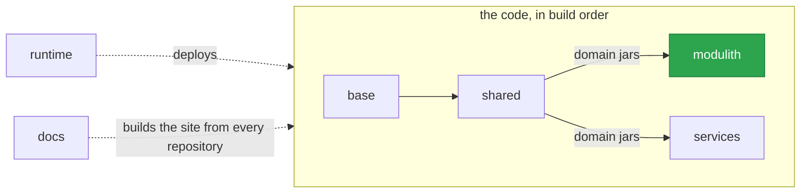

# FF Logistic: modulith

**FF Logistic as one Spring Modulith application: every business area in one process, wired in-process.**

Part of **[FF Logistic](https://github.com/ffetih/ff-logistic-docs)**: one logistics product built twice, as a modular monolith and as microservices, on the same Kubernetes platform, behind one switch. The business rules are written once; only the wiring differs. Start at the hub for the whole picture.

## What's here

| Path | What |
| :--- | :--- |
| `logistics-app` | The application: every domain core from shared, the chassis, and the `flows` module that wires the areas together |
| `deploy/apps/logistics-app` | Its values for the runtime's chart; the switch deploys it when `active: modulith` |

The same three flows as the services side, inside one JVM:

| Flow | Here |
| :--- | :--- |
| A road leg's distance (transportation asks routing) | A method call through the port |
| A delivery opens an arrival at the warehouse | A Spring Modulith event, recorded with the delivery in the outbox (schema `modulith`), delivered after the commit |
| A completed route stop delivers its shipment | The same, from routing to transportation, and on into the warehouse |

Spring Modulith's `ModularityTest` checks that no area reaches into another except through its API.

## Build

```bash
./build.sh    # after base and shared are installed
```

CI builds the image and publishes it to GHCR; Argo CD deploys it as a canary Rollout.

## Where it fits

Six repositories: base, then shared, then modulith and services are built in that order; runtime deploys them; docs builds the documentation site from all six. This one is green.



## Read more

- This repository's page on the documentation site: [Modulith](https://ffetih.github.io/ff-logistic-docs/modulith/index.html)
- The hub, with the architecture, the decisions and the plan: [ff-logistic-docs](https://github.com/ffetih/ff-logistic-docs)
- Every page, in one site: [ffetih.github.io/ff-logistic-docs](https://ffetih.github.io/ff-logistic-docs/)
